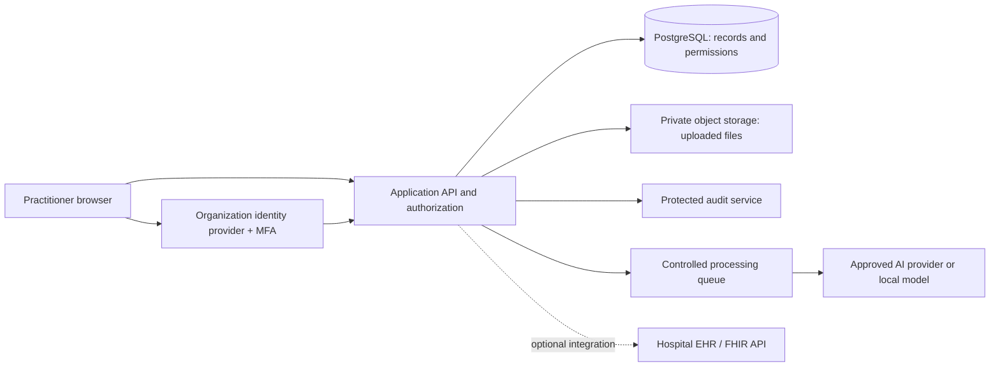

# Shared practice records: proposed implementation

Status: initial shared-practice implementation for synthetic evaluation, 15 November 2026. `/practice` now uses PostgreSQL, organization OIDC sign-in, patient care assignments, shared notes/medications, encrypted file originals, reviewed source-linked AI summaries and application audit history. The original anonymous SQLite prototype remains isolated. See [PRACTICE_SETUP.md](PRACTICE_SETUP.md) for setup and remaining rollout gates. Use synthetic data until a separate clinical deployment has been assessed and approved.

## Objective and architecture

Allow an authorized practitioner in a practice to find a patient and review approved notes, medication records, uploaded files and clearly labeled AI summaries. A patient's record belongs to an organization, not the browser session that created it. Access depends on verified identity, organization membership, role and a permitted care relationship. Practices remain isolated unless an explicit, governed cross-organization sharing agreement is implemented.

For a multi-user shared deployment, PostgreSQL is the recommended system of record; SQLite remains useful for local development. Object storage holds file bytes, while PostgreSQL holds metadata and access relationships. Never expose the database or storage directly to browsers. If a hospital EHR is authoritative, integrate through its approved APIs instead of silently creating a competing patient record. Select a specific FHIR version and map resources with the receiving institution; FHIR alone does not provide authorization.

## Proposed data model

Every clinical row carries `organization_id`; foreign keys and unique constraints enforce organization consistency. IDs are opaque UUIDs. All timestamps are server-generated UTC. This is a conceptual schema, not a migration.

| Entity | Key fields and purpose |
| --- | --- |
| organizations, practitioners, memberships | Organization; external identity subject; membership status, role and dates. Never infer identity from a browser cookie. |
| patients, patient_identifiers | Organization-scoped patient identity; source-system identifier and verification status. Avoid matching solely on name or date of birth. |
| care_relationships | Organization, practitioner, patient, relationship and validity dates; access grants and revocation. |
| encounters, note_versions | Patient, author, encounter, status, revision, signed version and timestamps. Corrections create amendments linked to the prior version. |
| medication_statements | Patient, medication code/display, dose, route, frequency, status, effective dates, source and verification. Distinguish reported medications from prescriptions and administrations; do not treat AI extraction as a prescription. |
| documents, document_versions | Patient, uploader, type, status, storage object key, MIME type, size, checksum, version, source and scan results. |
| ai_summaries, summary_evidence | Patient/encounter, source version IDs, model/version, generated time, review status, reviewer and source citations. Re-generation creates a new version; source changes mark summaries potentially stale. |
| audit_events | Actor, organization, action, resource, outcome, timestamp, reason and request correlation ID; no document bodies or secrets. |

## Access and user flow

1. The organization provisions a practitioner through its identity provider, with MFA and a revocable membership. The server validates tokens and establishes a short-lived secure session. The current anonymous session is not an authorization mechanism.
2. The user selects an organization and searches for a patient. The server applies tenant and patient-level authorization to every search, read, download, export and mutation; it must not trust UI filtering. Default deny when membership or relationship is missing. Avoid leaking record existence in errors.
3. Authorized staff upload a document. An upload record begins as pending; validate allowed types and size, inspect content and malware-scan in quarantine. Store an encrypted immutable object under a random key. Only publish it after scanning; failed scans remain unavailable. Audit upload, scan and download. Reauthorize every download and use short-lived, narrowly scoped access if signed URLs are used.
4. The practitioner reviews notes, source documents and medications. The system distinguishes verified records from unverified uploads and AI suggestions. Medication changes require a suitably authorized human and explicit workflow.
5. An AI job receives only the minimum approved source material through a contracted, configured provider or local model. Record source versions, model and output, validate citations and mark the result as a draft. A qualified reviewer approves it; never silently replace a signed note. Restrict AI access to source permissions, and recheck access when results are retrieved.
6. Audit successful and denied access, changes, exports, permission changes and emergency access. Emergency override, if the institution permits it, requires an explicit reason, alerts and retrospective review. Administrators managing accounts do not automatically receive clinical access.

Example policy: an active treating clinician may read a patient assigned to their care team and draft a note; an authorized reviewer may approve within institutional policy; an inactive practitioner or a member of another practice is denied. Define document types and particularly sensitive records with the institution. Role alone is insufficient.

## Implementation sequence and acceptance gates

1. **Discovery:** agree deployment jurisdiction, EHR ownership, patient matching, access matrix, retention, incident response and provider contracts. Produce threat model and data-flow inventory. Decide whether the app is a standalone practice record or an EHR-connected assistant.
2. **Repository boundary:** extract SQL operations from route handlers into interfaces with transaction support. Add versioned migrations and PostgreSQL implementation. Test transactions, optimistic concurrency and rollback against PostgreSQL. Keep SQLite for synthetic local runs.
3. **Identity and authorization:** add OIDC integration, MFA through the identity provider, memberships and patient-level policy checks. Remove automatic anonymous access in the shared deployment. Add positive and negative tests for every endpoint, including cross-tenant IDs, revoked membership, stale sessions and direct file URLs.
4. **Shared records:** add organization-scoped patients, encounters, immutable signed note versions, medication provenance and care relationships. Build search and review screens. Test concurrent edits, amendments, duplicate identifiers and patient merge procedures.
5. **Uploads and AI:** add quarantine, scanning, private object storage, quotas, versioning and cleanup for abandoned uploads. Add queued, permission-scoped summarization, evidence links, human review and stale-source handling. Test malicious files, oversized uploads, prompt injection, failed jobs and deletion/retention behavior.
6. **Audit and operations:** ship audit events to separately protected, monitored storage with restricted retention and review. Configure TLS, encryption at rest and key management, backups, restore drills, monitoring, alerting and incident procedures. Verify access revocation and disaster recovery in a staging environment.
7. **Migration and pilot:** inventory existing SQLite data; export from a consistent backup, validate counts and checksums, map each anonymous workspace to a verified organization and owner through an approved process, import transactionally into staging, reconcile, and obtain sign-off. Never automatically merge patients based on name/DOB. Freeze writes for final cutover, back up both systems, rehearse rollback and retain an audited migration report. Unmapped records remain quarantined. Pilot with synthetic records first; real data requires institutional approval.

## Integration, security and decisions

For interoperability, evaluate [FHIR Patient](https://hl7.org/fhir/R4/patient.html), [DocumentReference](https://hl7.org/fhir/R4/documentreference.html), [MedicationStatement](https://hl7.org/fhir/R4/medicationstatement.html) and [Provenance](https://hl7.org/fhir/R4/provenance.html). Map approved summaries and source references with the EHR vendor; preserve external identifiers and version history. Define conflict handling, retries and reconciliation before enabling writes.

Institutional policy and local law determine consent, legal basis, retention, disclosure and breach duties. For US covered entities, [HHS guidance](https://www.hhs.gov/hipaa/for-professionals/security/laws-regulations/index.html) describes access, audit, integrity, authentication and transmission safeguards; this design alone establishes no compliance. Obtain security, clinical, privacy and legal review, vendor agreements where required, and independent testing before real patient data.

Open decisions: hosting and jurisdiction; identity provider; EHR and FHIR version; patient identity source; care-team authorization rules; approved medication sources; file types/size; retention and legal holds; AI provider and retention terms; emergency-access policy; operational ownership and recovery objectives.

## Initial implementation scope

Versioned migrations and the service/repository boundary are implemented in `migrations/practice`, `practice-store.ts` and `practice-service.ts`. Initial uploads use bounded encrypted PostgreSQL payloads and synchronous PDF quarantine/scanning instead of object storage. AI generation is synchronous, reauthorizes before saving, retains source IDs/versions and requires explicit reviewer approval. The durable queue, private object-store adapter, EHR integration, patient merge/import tool, managed audit export and operational rollout remain future work. This staged scope does not establish hospital production readiness.
