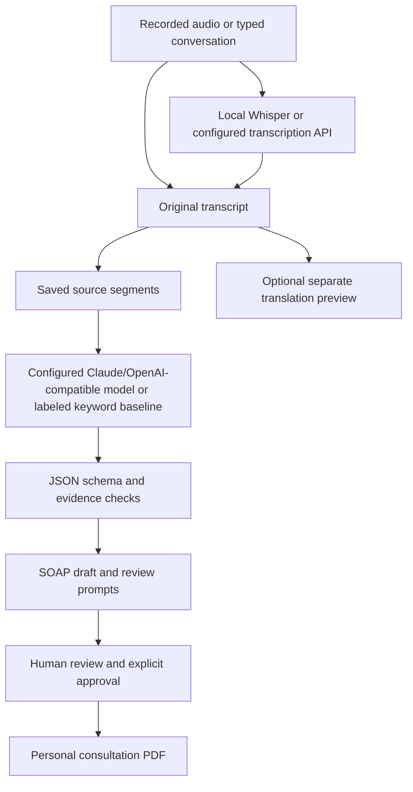
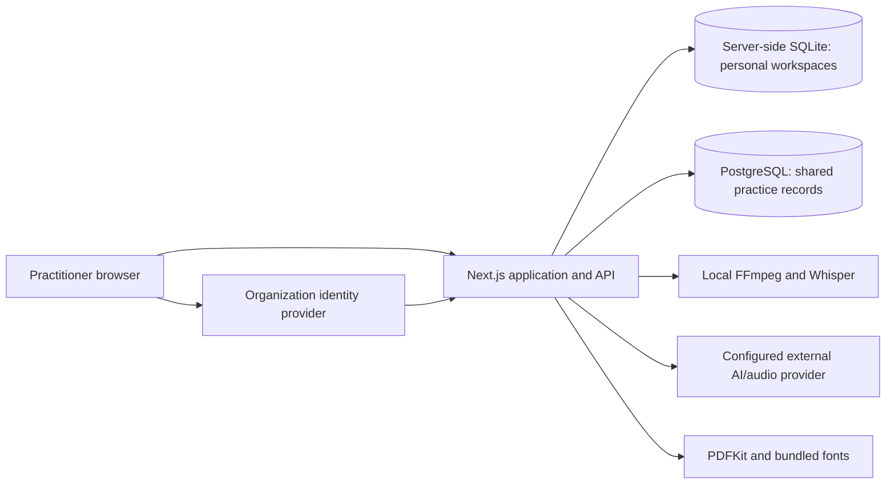

# Noticioner AI — project overview, current position and engineering audit

**Snapshot:** 15 November 2026, Asia/Singapore.  
**Repository:** `cliniscribe-ai` in the Nurse workspace.  
**Assessment:** functional local demonstration with an initial shared-practice implementation. Suitable for synthetic demonstrations; hospital production readiness has not been established.

This document consolidates the implementation, recorded verification, known flaws and possible next steps. It is an engineering status audit, not an independent penetration test, clinical validation or compliance certification. Existing evidence was reviewed for this document; the complete test suite was not rerun solely for this documentation change.

## Project overview

### What the project is

**Noticioner AI is a clinical documentation research prototype that turns a recorded or typed consultation into a source-linked, human-reviewed clinical note.** It began as a project for the Veritas AI hackathon and has expanded into a demonstration of shared hospital/practice records, doctor sign-in, care-team permissions, multilingual speech transcription, transcript translation and readable PDF reports.

Its central idea is to keep the conversation, extracted statements, uncertainty, speaker attribution and review decisions visible together. A practitioner should be able to inspect where a statement came from before approving it. The newer shared-record system adds a central organization-owned patient record so authorized colleagues can access notes, medication statements, source documents and reviewed AI summaries from different browsers or computers.

The intended benefit is less manual documentation work and a clearer review process. Actual time savings, improved patient outcomes and clinical safety have not been measured. The application assists with documentation; it does not make treatment decisions or replace the hospital's governance, practitioners or existing authoritative EHR.

### Who it is for

| User | Intended use | Current access model |
| --- | --- | --- |
| Doctor or clinician | Capture a consultation, review a draft and contribute patient documentation | Clinician membership plus the relevant patient assignment in the shared workspace |
| Nurse or other practitioner | Record source conversations and contribute information within assigned responsibilities | The implementation has general clinician/reviewer roles, not profession-specific licensing rules |
| Clinical reviewer | Check evidence, resolve uncertainty, approve records and manage patient care access | Reviewer role plus patient edit access |
| Colleague with viewing access | Read the assigned patient's history and download available source documents | Active membership plus a patient view-only assignment |
| Practice administrator/operator | Provision identities and manage memberships or care assignments | Administrative capability does not automatically provide clinical read access |
| Developer, evaluator or demonstration audience | Exercise the pipeline and inspect its behavior using fictional records | Empty personal workspace or the isolated sample hospital |

The current supported use is synthetic demonstration and engineering evaluation. Professional credentials are not independently verified by the application; real organizational identity and authorization policy must supply that assurance.

### The clinical note format

The personal consultation workflow produces a **SOAP** draft:

| Section | Meaning | How the prototype treats it |
| --- | --- | --- |
| Subjective | What the patient reports, such as symptoms and history | Retains source references and speaker attribution |
| Objective | Observations or measurements reported by a practitioner | Patient guesses must not silently become objective findings |
| Assessment | Interpretation explicitly stated by the clinician | The model is instructed not to invent a diagnosis |
| Plan | Actions or follow-up stated in the conversation | The model is instructed not to invent treatment, prescriptions or doses |

Each extracted statement has a section, category, text, certainty label and evidence references. Categories include complaint, duration, history, allergy, medication, examination, assessment, follow-up and other. The certainty labels are **Supported**, **Uncertain** and **Unsupported**. “Supported” means the software accepted its source linkage; it is not a clinical correctness guarantee.

Speaker labels are **Doctor**, **Nurse**, **Clinician**, **Patient** or **Unknown**. Their basis can be **Explicit**, **Inferred** or **Unknown**. The model can interpret unlabeled conversational text, but this is contextual role inference, not acoustic speaker diarization, voice identification or proof of a person's identity.

### Main product areas

| Area | What the user sees or does |
| --- | --- |
| Overview | Workspace activity, consultation status and entry into a new consultation |
| Patients | Create/search fictional patient records and maintain the personal workspace's history, allergies and medication context |
| Consultations | Open a record, paste or record source text, save it, generate a draft, inspect evidence, edit, review, approve and export |
| AI Evaluation | Run the provided synthetic extraction benchmark and inspect metrics and errors |
| Analytics | View counts and charts calculated from stored workspace activity; no claimed productivity savings |
| Settings | Inspect provider/audio configuration status and prototype limitations; secret values are not displayed |
| Doctor portal `/doctor` | Enter organization sign-in or resume a practice session |
| Shared practice `/practice` | Open an assigned patient and use Notes, Medications, Documents, AI summaries, Care team and Activity |

The interface uses a responsive React layout with navigation, patient directories, source/draft panels, review controls, empty states and explicit error messages. The presence of a control is not the authorization boundary: the server checks the corresponding operation independently.

### Personal consultation journey

1. Open the personal workspace. The server creates an isolated workspace represented by a random browser cookie; no practitioner login is implied.
2. Add a fictional patient's name and date of birth, with optional history, allergies and medication context.
3. Create a consultation and enter its source conversation by typing, pasting or recording audio.
4. For audio, check consent, choose the spoken language, record and stop. Listen, download or transcribe the recording. Review the transcript before saving it.
5. Save the transcript. Choose the real configured AI provider or the clearly labeled offline keyword baseline.
6. Generate a SOAP draft. Compare statements with their source quotations and inspect explicit/inferred/unknown speaker attribution.
7. Edit the draft and address review prompts, including uncertainty and missing medication documentation. Review actions retain a reviewer note.
8. Explicitly approve the reviewed version, then export a PDF and reopen the saved consultation when needed.

The patient's contextual fields are shown for manual review; they are not automatically all sent as generation input. The personal generation pipeline uses the saved transcript. Personal workspace deletion is separate from shared-record retention: it can delete that anonymous workspace and its associated records.

### Shared hospital/practice journey

1. An operator provisions a verified organization identity and membership. A new browser is not automatically a doctor account.
2. The practitioner opens the doctor portal and authenticates through the organization's identity provider. The local sample provider can demonstrate this flow using fictional accounts.
3. The server resolves the session, organization role and patient care assignments, then returns only authorized directory results.
4. An authorized clinician can create a patient using an organization-scoped identifier and choose a reviewer under the current creation policy. The creator and selected reviewer receive edit assignments.
5. Editors add clinical notes, medication statements and allowed source documents. Reviewers approve exact record versions. Approved-note corrections use amendments.
6. A reviewer can grant another active practitioner view-only or editing access, update the assignment, or revoke it. The next request rechecks access.
7. Editors can generate summary drafts from selected approved notes and supported text documents, inspect quotations and source versions, and seek reviewer approval.
8. Activity history records reads, changes, document downloads, source disclosure and permission actions. Full protected external audit storage remains future work.

The wider database belongs to the organization rather than a particular browser. There is no automatic copying of anonymous SQLite records into it, no demographic-based patient merge and no implemented cross-organization sharing agreement. If an existing hospital EHR owns the authoritative record, integration must be designed explicitly rather than assuming this prototype replaces it.

### Record states and version behavior

| Record path | Current lifecycle |
| --- | --- |
| Personal consultation | Draft → Needs Review after generation → Reviewed after required review actions → Approved after explicit confirmation |
| Personal source change | Saving a changed transcript increments the revision and invalidates the current draft; stale generation must not overwrite a newer source |
| Personal note edit | Creates a retained note version and resets the relevant documentation review |
| Personal approval | Makes clinical editing read-only; the prototype still has explicit deletion/export operations |
| Shared note | Draft → reviewer approval; approved records are protected by database triggers, and corrections create an amendment |
| Shared summary | Generated draft → human review/approval; uncertain or unsupported statements block approval, and source changes can make it stale |
| Translation | Temporary, unreviewed preview associated with the displayed source; it does not replace, approve or automatically save a medical record |

Version checks, transactions and record locks protect important mutation paths. They are engineering safeguards, not certified electronic signatures or a complete medico-legal record lifecycle.

### AI, transcription and translation pipeline

- **Note generation:** native Claude Messages structured output and an OpenAI-compatible adapter are implemented. The application uses pretrained models through configured providers; it does not train a new clinical foundation model.
- **Offline baseline:** deterministic English keyword rules provide a credential-free demonstration and evaluation baseline. It is not presented as AI or a reliable substitute for clinical interpretation.
- **Output checking:** Zod validates structure and bounds. Evidence quotes must exist in their referenced source segments. Missing, invalid, truncated or refused results are rejected instead of silently becoming approved records.
- **Clinical instructions:** source text is treated as untrusted data; the model is instructed to preserve negation, corrections and uncertainty and avoid invented diagnoses, prescriptions, measurements or doses. Prompting does not guarantee these outcomes.
- **Local audio:** FFmpeg decodes supported containers and Whisper transcribes the selected language. Temporary files are removed, child processes receive a restricted environment and the local mode has no automatic cloud fallback.
- **Cloud audio:** uses the configured transcription endpoint and credential. AI note-generation and speech credentials are separate capabilities; a Claude key alone does not configure a cloud speech API.
- **Translation:** sends the displayed source and selected target language to the configured model after authorization. The preview includes model provenance, can be copied, and is hidden when its source becomes stale.
- **Shared summaries:** use selected approved notes and available text documents, retain source IDs/versions and quotations, and recheck care access after generation. They do not automatically rewrite notes or medication lists.

### Language and document support

| Language | Code | Current scope |
| --- | --- | --- |
| English | `en` | Spoken-language selection, transcript text, translation target and PDF text |
| French | `fr` | Same supported workflows |
| Mandarin Chinese | `zh` | Same supported workflows; script output depends on the model |
| Malay | `ms` | Same supported workflows |
| Japanese | `ja` | Same supported workflows |
| Korean | `ko` | Same supported workflows |
| Spanish | `es` | Same supported workflows |
| Tamil | `ta` | Same supported workflows |
| Danish | `da` | Same supported workflows; the recorded local smoke example contained recognition errors |

These selections do not mean equally validated accuracy across languages, dialects or clinical terminology. Interface translation is not implemented. English-only Whisper models are restricted to English requests. The default local setup now downloads the multilingual `ggml-base.bin` and verifies its checksum.

Shared source uploads currently accept UTF-8 `.txt` and appropriately scanned `.pdf` files, up to 5 MB. PDF upload does not imply PDF text extraction: automatic summarization currently uses approved notes and supported extracted text from text uploads. Original file bytes are encrypted in PostgreSQL; private object storage is still part of the target architecture.

### Technical architecture

The application is a server-backed Next.js web app, not a static site or a browser-only SQLite engine. **SQLite files and PostgreSQL access run on the server.** The browser sends requests to application APIs and never receives database credentials or direct SQL access.

| Layer | Implementation |
| --- | --- |
| Runtime | Node.js 24.8+ |
| Application | Next.js App Router, React, TypeScript |
| Input and AI-output validation | Zod |
| Personal persistence | Node's built-in SQLite API, migrations and transaction helpers |
| Shared persistence | PostgreSQL through `pg`, versioned SQL migrations and service/repository functions |
| Identity | Organization OIDC, `jose` token verification and hashed application sessions |
| Local speech | whisper.cpp plus FFmpeg; native tools/models are installed separately |
| AI services | Configured Claude or OpenAI-compatible adapters |
| Reports | PDFKit with embedded Noto Latin, CJK/Korean and Tamil fonts; pdf-lib is also used in verification |
| Interface assets | DM Sans/Manrope through Fontsource, Lucide icons and Recharts |
| Verification | Node test runner/tsx, ESLint, TypeScript, Playwright, temporary embedded PostgreSQL and PDF rendering/extraction checks |

### Main data entities

| Personal SQLite | Shared PostgreSQL |
| --- | --- |
| Workspace users and hashed sessions | Organizations, practitioners, memberships and practice sessions |
| Patients with contextual fields | Organization-scoped patients and identifiers |
| Consultations with transcript, draft, review flags and status | Care relationships with active/view/edit permissions |
| Note-version history | Clinical notes, note versions and amendment links |
| Workspace activity/audit events | Medication statements with provenance |
| Evaluation runs and request limits | Documents with metadata, checksum, status, encrypted bytes and optional text |
| Ownership relationships enforce browser-workspace isolation | Summaries with source/version metadata, practice audit events, OIDC flows and request limits |

Both systems retain server-generated identifiers and timestamps. Shared composite keys and foreign keys constrain tenant consistency. They remain separate stores with different authentication, deletion and approval semantics; sharing a product interface does not merge their databases.

### API families

| Family | Main operations |
| --- | --- |
| `/api/session`, `/api/bootstrap`, `/api/workspace` | Open/read/end or explicitly delete an anonymous personal workspace |
| `/api/patients`, `/api/consultations` | Personal patient and consultation operations |
| `/api/consultations/:id/...` | Generate, edit notes, review flags, approve, inspect audit/versions, translate and export PDF |
| `/api/transcribe`, `/api/evaluation/run` | Personal audio transcription and synthetic evaluation |
| `/api/practice-auth/...` | Practice session status, login, callback, logout and organization switch |
| `/api/practice/bootstrap` | Authorized practice directory, membership/context and provider capabilities |
| `/api/practice/patients/:id` | Authorized shared patient details |
| `/api/practice/patients/:id/...` | Notes, medication statements, source files/downloads, summaries, grants, transcription, translation and permitted approvals |

These are application endpoints, not an implemented FHIR server. Shared-patient report export, EHR synchronization and migration/import APIs are not complete features.

### How to run the project

**Personal synthetic workspace:** from the repository root, install dependencies with `npm ci`, then run `npm run dev` and open `http://127.0.0.1:3000`. The personal SQLite schema is initialized automatically. Its empty workspace, baseline, review flow and PDF export do not require an AI key. A production build uses `npm run build` followed by `npm start`.

**Optional AI:** copy `.env.example` to ignored `.env.local` and configure the selected provider. Relevant variable names include `AI_PROVIDER`, `ANTHROPIC_API_KEY`, `CLAUDE_MODEL`, `OPENAI_API_KEY` and `AI_MODEL`, with optional trusted endpoint settings. The machine's configured key values are private and are not included in this document. The earlier running personal instance used port 3108; that was a session-specific server setting rather than the default port.

**Optional local audio:** install whisper.cpp and FFmpeg, run `npm run setup:transcription`, set `STT_PROVIDER=local`, and configure `LOCAL_WHISPER_MODEL`, `LOCAL_WHISPER_BIN` and `FFMPEG_BIN` as needed. Restart the app after changes. `STT_API_KEY`, `STT_BASE_URL` and `STT_MODEL` configure a cloud alternative. Local capture itself remains possible before transcription is ready.

**Sample hospital:** run `./scripts/demo-start.sh`, or build and run `npm run demo:server`. Open `http://127.0.0.1:3109/doctor` and choose organization sign-in. The sample accounts are:

| Email | Name | Assignment on Alex's sample record |
| --- | --- | --- |
| `reviewer@demo.local` | Dr Maya Chen | Review, edit and manage access |
| `doctor@demo.local` | Dr Daniel Lim | Add clinical records |
| `viewer@demo.local` | Dr Aisha Rahman | View and download only |

The deliberately public demo password is **`DemoDoctor!2026`** and simulated verification code is **`123456`**. This is not real MFA. Alex Tan and Priya Kumar are fictional sample patients; Priya is assigned only to the reviewer. The sample summary is explicitly labeled as a prewritten fixture, not a live model result. Press Ctrl+C in the runner to stop the local services; the sample records remain for restart.

**Actual shared practice:** configure a PostgreSQL deployment, `PRACTICE_APP_ORIGIN`, OIDC issuer/client/assurance variables and `PRACTICE_FILE_KEY`. Apply `npm run practice:migrate`, provision verified subjects using `npm run practice:provision`, and follow the complete [PRACTICE_SETUP.md](PRACTICE_SETUP.md) procedure. Standalone operator scripts read exported environment variables; do not assume they load `.env.local`. A shared-only deployment requires `PRACTICE_ONLY=true` at build and runtime. Keep the sample identity provider separate from this deployment.

### Persistence, disclosure and recovery boundaries

- A personal workspace's cookie grants access to its server-owned records; it is not an account recovery mechanism. Clearing the cookie can lose access without deleting the database records.
- Shared records use the organization's database and identity memberships, so another authorized practitioner can access the same assigned patient from another computer.
- Browser recordings are initially held in memory. Temporary local processing files are removed; durable audio storage and recovery are not implemented. Download a recording before leaving if it must be retained for a synthetic demonstration.
- Shared uploaded originals use application-level encryption; database content and backups require separate infrastructure protection. The file key is required to recover encrypted originals.
- AI note generation, translation and optional cloud transcription can disclose submitted source material to the configured provider. Local Whisper processing does not itself send audio to a cloud service.
- Translation previews are separate from original transcripts and are not automatically included in medical records or report exports.
- Application logs and audit history are not a replacement for independently protected operational and clinical audit services.

### Evaluation and what the reported scores mean

The built-in extraction evaluation has **eight synthetic, development-visible cases** covering symptoms, ambiguity, corrections, medication wording, uncertainty and unknown speakers. It measures reference category/source-segment matching rather than diagnosis quality, translation accuracy, voice identification or clinical safety.

| Historical run, 14 November 2026 | Precision | Recall | F1 | Recorded errors |
| --- | --- | --- | --- | --- |
| Keyword baseline | 88.46% | 92.00% | 90.20% | 3 false positives, 2 false negatives |
| Claude extraction run | 92.31% | 96.00% | 94.12% | 2 false positives, 1 false negative |

These are historical results from the repository's small visible dataset, not new runs or evidence of general superiority. Source-quote matching verifies that quoted text exists; it does not prove that a generated statement has the right clinical meaning. Evaluation definitions, examples and complete artifacts are in [EVALUATION.md](EVALUATION.md) and `evaluation-results/`.

Routine commands include `npm run lint`, `npm run typecheck`, `npm test`, `npm run build`, `npm run test:server`, `npm run test:practice` and `npm run test:e2e`. `npm run evaluate` runs the baseline; `npm run evaluate -- --ai` uses the configured provider and its normal API usage. The current GitHub Actions definition runs lint, typecheck, general tests, build and production HTTP checks. PostgreSQL and full real-demo browser jobs are recommended additions, not already completed CI coverage.

### Project scope and ownership of decisions

The implemented product is a reviewable documentation and shared-record prototype. It has no certified electronic signature, independently validated clinical model, verified medication-interaction database, acoustic diarization, automated prescribing, implemented EHR integration, governed patient merge/import process or established hospital deployment approval. Emergency access and cross-organization sharing are future institutional design decisions.

The repository includes a Dockerfile, but container deployment has not been fully verified. A static host such as GitHub Pages cannot run the application's server APIs and databases. A hospital deployment needs an appropriately managed server environment, real identity integration, protected storage and backups, operations ownership and institutional review.

The project was built with assistance from OpenAI Codex. Reference labels and synthetic examples are project-authored rather than independently clinically annotated. Interface and report fonts retain their accompanying open licenses. The remaining sections describe the current engineering position, evidence, flaws, release gates and next steps in detail.

## 1. Current position

The project has two separate record systems and a demonstration environment:

| Area | Current behavior | Boundary |
| --- | --- | --- |
| Personal workspace `/` | Browser-isolated SQLite patients and consultations; transcription, SOAP drafts, review, approval and PDF export | Anonymous synthetic workspace; its cookie does not identify a doctor |
| Doctor portal `/doctor` | Checks the practice session and starts organization OIDC sign-in | Actual hospital database/identity-provider configuration remains outstanding |
| Shared workspace `/practice` | PostgreSQL patients, care assignments, notes, medication statements, encrypted uploaded originals, AI summaries and audit activity | Requires an active membership and patient-level access |
| Local sample hospital | Working doctor login against a separate sample identity service and persistent PostgreSQL database | Loopback-only, synthetic records, public sample credentials and simulated verification |

The sample server was last verified at **http://127.0.0.1:3109/doctor** and opened in Safari. Its identity service uses `127.0.0.1:4111`; its PostgreSQL instance uses `127.0.0.1:55433`. These are local endpoints, not a public deployment. Starting instructions and sample credentials are in [DEMO_SERVER.md](DEMO_SERVER.md).

The demonstration runner uses ignored `data/practice/demo/` state, binds services to loopback and does not replace the real hospital configuration in `.env.local`. Demonstration records survive a clean restart. Seeding does not overwrite care assignments changed during a demonstration.

The working tree contains substantial modified and untracked implementation files. Changes have not been committed or pushed as part of this work. A clean-clone installation and release handoff still need to be established. The separate `github-upload` directory should not be assumed to contain the current implementation.

## 2. Implemented capabilities

### Identity and permissions

- Organization OIDC authorization-code sign-in with S256 PKCE, state, nonce, signature, issuer, audience, expiry and configured assurance checks.
- Hashed one-hour application sessions, membership checks and organization switching.
- Organization roles: clinician, reviewer and administrator. Administrators do not automatically receive clinical read access.
- Patient assignments distinguish **View only** from **Can edit**. New grants default to view-only. Migration 003 preserves existing assignments' prior editing capability.
- Clinical writes check membership and care access inside transactions. File processing, AI generation, transcription and translation recheck access before returning or saving results.
- Approval and care-team management require reviewer privileges plus patient edit access, or the existing operator administrative workflow for assignments.
- The sample service demonstrates real signed-token login, incorrect-password rejection, logout and different patient permissions. Its displayed verification code is explicitly simulated, not real MFA.

### Shared records and database

- Versioned PostgreSQL migrations, organization-scoped composite keys and tenant-consistent foreign keys.
- Organization-scoped patient identifiers, assigned-patient search and initial reviewer assignment for clinician-created patients.
- Approved notes and summaries are immutable through database triggers. Approved-note corrections use amendments; note versions and audit history are append-only under ordinary database operations.
- Medication statements retain reported/verified/stopped status and source context. These entries are not prescriptions.
- Uploaded originals are bounded, encrypted with AES-256-GCM and served through authorization checks. UTF-8 text is supported; PDF admission requires a configured scanner and rejects scan failure.
- AI summaries retain source IDs/versions and quotations, require review, and can be marked stale after approved amendments.

### Recording, languages and translation

- Recording is independent of transcription-provider readiness, with consent, supported container selection, pause/resume/stop, playback, download and discard.
- Recording is available in personal consultations and shared Notes for editors. View-only users cannot submit shared transcription requests.
- Spoken-language selection supports English, French, Mandarin, Malay, Japanese, Korean, Spanish, Tamil and Danish.
- Local multilingual Whisper and FFmpeg were repaired on this machine. Local processing supports one clip at a time, up to three minutes; audio uploads are capped at 20 MB.
- An optional configured cloud transcription adapter forwards the selected language. Local mode does not silently fall back to a cloud provider.
- Translation uses the configured AI provider and returns a separate, unreviewed preview. It preserves the original editor text, labels model provenance and hides stale previews when the source changes.
- Interface labels remain English. Language selection and native-script content support do not constitute full interface localization.

### Reports and interface

- Personal-consultation PDFs use PDFKit and bundled OFL-licensed Noto fonts for supported Latin, Tamil, CJK and Korean text.
- PDF paragraphs, long-word wrapping, page flow, margins, provenance and footers have been corrected and visually inspected.
- The shared interface exposes notes, medications, documents, summaries, care assignments and activity. Mutation controls follow server-derived patient permissions.
- Access-failure handling clears cached clinical detail. Expired/revoked sessions return to sign-in, and callback errors are visible.

## 3. Verification evidence and its limits

These are the most recent recorded results for each relevant runner. They were executed in different rounds; overlapping tests must not be added together as a unique test count.

| Check | Last recorded result | What it establishes |
| --- | --- | --- |
| ESLint, TypeScript, production build | Passed | Static checks and a build of the implemented application |
| General unit/integration runner | 44 passed; 2 database-dependent tests skipped | Application logic, provider validation, recording tools, translation, PDF creation and demo-mode guards |
| Isolated PostgreSQL runner | 8 passed; none skipped | Actual migrations/service/database boundaries, tenant separation, view-only denial, approvals, revocation and processing rechecks |
| Practice/recording/portal UI runner | 12 passed | UI state and request contracts; many API and media responses are mocked |
| Sample-server browser runner | 3 passed | Actual local OIDC login without identity/API mocks, failed-password recovery, reviewer/editor/patient-view access, document download, logout and invalid-request rejection |
| Production HTTP runner | 3 passed | Existing consultation persistence/review/export workflow against a disposable SQLite database |
| PDF visual and extraction QA | Short and multilingual one-page reports; all four long-report pages checked | Observed layout quality, supported-script extraction and horizontal text bounds for the supplied fixtures |
| Local speech smoke checks | Nonempty output for eight synthetic TTS language examples | Working local audio pipeline and language forwarding; **not** an accuracy benchmark |
| Live Claude translation smoke check | One French-to-English example passed | Connectivity and preservation of negation and `5 mg` in that example only |
| Demo lifecycle | Clean stop and persistent restart passed | Demonstration state survives the exercised restart path |

Physical microphone behavior and permission prompts on the user's Safari have not been independently verified. Existing speech tests found substantial recognition errors in the short Danish example. Clinical transcription/translation accuracy, broad browser compatibility, accessibility, deployment resilience and independent security assurance remain unestablished.

Read-only review subagents rated the shared-record, language, translation/PDF and sample-server rounds at approximately **8.2–8.4/10 for their documented synthetic scope**. These are engineering review judgments, not hospital readiness scores. Historical reports describe different rounds and scopes; they should not be treated as one independent certification.

## 4. Known flaws and outstanding risks

Priority describes follow-up order. **Release gate** means required before real patient deployment, rather than a claim that a particular exploit has been demonstrated.

| ID | Priority | Finding and evidence | Consequence / required follow-up |
| --- | --- | --- | --- |
| A01 | Release gate | The working login demonstration uses public sample credentials, a displayed verification code and explicitly restricted HTTP transport. The real institution's IdP is not connected. | Keep it local and synthetic. Configure real HTTPS/OIDC/MFA, account provisioning, revocation and institutional identity policy for a pilot. Never publish or tunnel the sample identity service. |
| A02 | Release gate | Uploaded originals are encrypted in PostgreSQL, but extracted text, notes, medications, translations in memory and summary content do not receive the same application-level file encryption. File-key rotation is absent. | Define database/backup encryption, managed key storage, access separation, rotation and recovery. Losing the file key loses access to existing encrypted originals. |
| A03 | Release gate | Audit events are stored in the application database. Triggers are not protection against a privileged database owner, and denied-event recording failures can be swallowed. | Export to separately controlled audit storage; monitor gaps/failures and define retention, review and incident procedures. Add request correlation and operational alerts. |
| A04 | Release gate | Real hosting, least-privilege deployment credentials, backup restore drills, monitoring, incident response, retention/legal-hold policy and institutional sign-off are incomplete. The embedded demo database is not a production deployment. | Establish operational ownership and recovery criteria, then prove them in staging before accepting patient data. |
| A05 | High | “View only” is a **patient assignment**, not a global organization role. The sample viewer has a clinician membership and can create a different patient under current policy. | Decide whether a true organization-wide viewer role is required; if so, add it through schema, policy, provisioning, API and UI tests. Keep existing labels explicit about per-patient scope. |
| A06 | High | Shared lists are capped: notes/medications/documents at 200, summaries at 100 and activity at 50. Directory search has an explicit 250-result limit, but full clinical-history pagination is absent. | Add cursor pagination, visible continuation/counts and complete-history/export workflows so older records are not mistaken for missing information. |
| A07 | High | Shared “Can edit” currently enables adding records and permitted review actions; there is no full versioned draft-note editing interface or medication reconciliation/update workflow. | Add draft editing with optimistic concurrency and preserved revisions. Link medication changes to prior statements with effective dates and verification, rather than relying on separate unlinked entries. |
| A08 | Medium | PDF improvements apply to the personal-consultation export route. A complete shared-patient report/export endpoint is not implemented. | Define shared-report scope, patient/source versions and export permissions; audit export and test cross-tenant denial and multilingual layout. |
| A09 | High | AI summaries and translation can be clinically wrong despite valid JSON or exact source quotations. The baseline is English keyword extraction. Prompt injection and semantic errors remain possible. | Maintain explicit review; build held-out, independently reviewed multilingual evaluation for negation, dose/units, corrections, speaker attribution and factual support. Do not infer clinical safety from smoke tests. |
| A10 | Medium | Audio stays in browser memory before submission. There is no durable recording recovery, streaming transcription or shared cross-session draft autosave. Recording/transcription has its own busy state. | Add loss prevention and progress/cancel behavior. Prevent note submission during pending transcription, and ensure late results cannot populate a newly saved draft unexpectedly. |
| A11 | Medium | A stale edit attempt after an access downgrade can send a still-valid view-only user back to sign-in on HTTP 403. A reviewer can remove their own assignment without a last-reviewer safeguard. | Refresh into read-only mode where appropriate and define safe transfer/last-reviewer rules with an operator recovery path. |
| A12 | High | File storage and processing remain initial implementations: synchronous scanning/AI/transcription, no private object-store adapter, durable distributed queue, tenant storage quota or mature retention lifecycle. PDF text extraction is absent. | Introduce immutable object versions, quotas, durable jobs, cancellation/retry policies and scanner monitoring. Recheck access at processing/disclosure boundaries. |
| A13 | Medium | Summary source references are JSON metadata rather than a normalized evidence/version relationship enforced entirely by foreign keys. Clinical history remains an initial model. | Normalize evidence references and version relationships where required; specify supersession, reconciliation and consistency checks before large-scale integration. |
| A14 | High | Membership provisioning/revocation is operator-managed. Automated IdP directory synchronization, organization-wide session revocation and full identity-provider logout integration are not established. | Define account lifecycle, deprovisioning, session invalidation, recovery and role-change workflows; test them against the chosen institution's IdP. |
| A15 | Medium | Runtime/native tools, large font assets, platform-specific embedded PostgreSQL and local secrets need a reproducible delivery process. Docker, clean-clone setup and other operating systems have not been fully verified. | Exercise a fresh install/build/deploy, pin and maintain native tools, validate asset tracing and document ownership of upgrades. Never commit local keys or database files. |
| A16 | High | Patient merges, governed SQLite import, EHR integration and conflict reconciliation are not implemented. Cross-organization sharing is not enabled. | Agree the authoritative record source, identifiers, consent/access policy and integration contract. Never merge patients automatically by name or date of birth. |

## 5. Recommended next implementation rounds

### Round 1 — make the demonstration reproducible

1. Review the large working-tree change set and commit it as a coherent, documented baseline; verify a clean clone.
2. Run the sample server on a second installation, including restart and occupied-port behavior. Keep the three-account walkthrough repeatable.
3. Add CI jobs for PostgreSQL and actual demo OIDC browser tests, with isolated ports/state and no real provider keys.
4. Consolidate historical status documents and link this audit as the current snapshot. Preserve historical evidence without presenting old counts as current totals.

**Acceptance:** a new developer can install, start the sample hospital, demonstrate all three patient-permission levels, run the relevant checks and stop it without touching other data.

### Round 2 — close record correctness and UX gaps

1. Implement complete clinical-history pagination and clear result limits.
2. Resolve global-viewer versus patient-view-only policy and add the chosen role tests.
3. Add versioned draft-note editing, medication reconciliation and last-reviewer/transfer safeguards.
4. Coordinate recording, transcription and note-saving states; improve read-only recovery after downgrade.
5. Add an authorized shared-patient report/export workflow with the same font/layout checks.

**Acceptance:** users can discover the complete history, correct drafts safely, understand their permissions and export only authorized record versions; concurrency and negative-access tests pass.

### Round 3 — build a controlled staging deployment

1. Connect the actual IdP with institution-approved MFA assurance and provisioning/deprovisioning.
2. Use separately managed runtime/migration credentials, managed keys, private storage and protected audit export.
3. Add durable processing jobs, quotas, health checks, logging/alerts and cleanup policies.
4. Rehearse backup restoration, key recovery, access revocation and a deployment rollback.

**Acceptance:** documented staging evidence meets agreed operational and security criteria. Use synthetic data until institution-specific approvals are complete.

### Round 4 — evaluate clinical and integration behavior

1. Establish held-out multilingual transcription, translation and summarization evaluations with qualified reviewers.
2. Select an EHR/FHIR integration contract if the hospital already has an authoritative record system.
3. Design patient matching, import reconciliation, amendment/supersession and retention policies.
4. Obtain independent security/accessibility assessment and institutional clinical/privacy review before a limited real-data pilot.

**Acceptance:** measured quality and deployment evidence support a specifically approved use case; no generalized clinical or compliance claim is inferred from the local demo.

## 6. Decisions to resolve

- Who owns the authoritative patient record: this application or the existing hospital EHR?
- Which practitioners may create patients, approve records, manage care grants or only view?
- Which identity provider, hosting environment and operational team will support the deployment?
- What are the retention, deletion, audit review and recovery requirements?
- Which AI/transcription providers and languages are approved, and what validation thresholds are required?
- Which record types, exports and cross-department or cross-organization disclosures are permitted?

## 7. Supporting documents and code entry points

- [DEMO_SERVER.md](DEMO_SERVER.md): local sample server, accounts and walkthrough.
- [PRACTICE_SETUP.md](PRACTICE_SETUP.md): actual shared deployment configuration and access permissions.
- [HOSPITAL_DATA_ARCHITECTURE.md](HOSPITAL_DATA_ARCHITECTURE.md): target architecture and staged migration.
- [DOCTOR_PORTAL_TRANSLATION.md](DOCTOR_PORTAL_TRANSLATION.md): portal, translation and PDF implementation evidence.
- [RECORDING_LANGUAGES.md](RECORDING_LANGUAGES.md): audio setup, languages and observed recognition limits.
- [SECURITY.md](SECURITY.md), [LIMITATIONS.md](LIMITATIONS.md), [PRACTICE_REVIEW.md](PRACTICE_REVIEW.md): boundaries and historical review evidence.
- `src/lib/practice-auth.ts`, `practice-demo.ts`, `practice-store.ts`, `practice-service.ts`: identity, demo guard, database and policy enforcement.
- `migrations/practice/`: shared schema, integrity and access migrations.
- `scripts/demo-server.ts`, `demo-identity.ts`, `demo-seed.ts`: isolated demonstration lifecycle and sample identity/data.
- `src/components/recorder.tsx`, `transcript-translation.tsx`, `src/lib/pdf.ts`: recording, translation preview and report rendering.

**Next review trigger:** update this file after a material change to identity policy, database schema, permission behavior, processing/storage architecture, deployment status or verification evidence.
